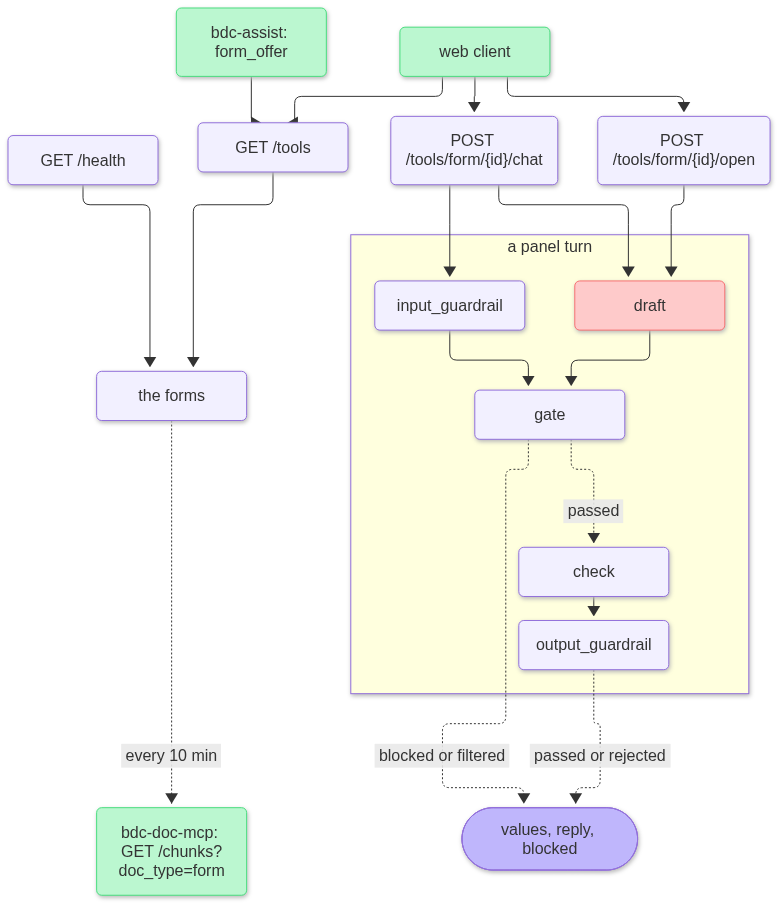

# bdc-side-panel

The backend of BDC Assist's side panel (bdc-assist#64, #66): it drafts the BDC website's forms (Get Help, Contact
BDC, cloud credits, publication submission, newsletter) from the chat, and refines the draft by chatting in the
panel. The user checks the draft and opens the real form with the values as URL parameters, where they submit it.

BDC-specific on purpose. bdc-assist, bdc-doc-mcp and bdc-doc-builder stay general purpose and are specialized only
by their config; everything BDC-specific about the panel lives here. Nothing here imports them: what it reuses
(the LLM setup, admission control, JSON error handlers) is copied in.

Later the same service will carry the panel's knowledge-graph tools, beside the form routes under `/tools/kg/`.



The endpoints, who calls them, and one panel turn, drawn like bdc-assist's workflow pictures (by hand, from
[docs/workflow.md](docs/workflow.md)'s mermaid, which says how to redraw it). Arrows go from caller to callee;
green boxes are other services.
- **The forms** come from bdc-doc-mcp, fetched again every 10 minutes. `open` and `chat` look their form up there
  too, and wait for a free slot (503 when busy) before the turn starts.
- **input_guardrail** (chat turns only) screens the panel message, beside the draft.
- **draft** is the one structured-output LLM call (pastel red).
- **gate** ends the turn when the message was blocked or the provider's content filter refused a call.
- **check** is the server's checks on what the LLM wrote.
- **output_guardrail** rejects a draft that has no place in a help request.
- A blocked or rejected turn changes nothing: canned reply, values unchanged.

## Run

```sh
uv sync
cp .env.example .env   # then fill in the LLM settings (bdc-assist's names and values work as they are)
uv run uvicorn side_panel.api:app --port 8012
```

It needs bdc-doc-mcp (`DOC_MCP_URL`, default `http://127.0.0.1:8001`) with the `form` doc type ingested
(bdc-doc-builder's `fence: form` row over bdc-llm). Tests: `uv run pytest`.

## Where the forms come from

bdc-llm's pages carry each form as a ```` ```form ```` YAML block. bdc-doc-builder ingests each block as a `form`
document, and bdc-doc-mcp's `GET /chunks?doc_type=form` lists them. This service fetches that list when first
needed and again every `FORMS_REFRESH_SECONDS` (600). A failed fetch keeps the last list, and a block that doesn't
parse is logged and skipped. So a form edited in bdc-llm reaches the panel after the next ingest, with no code change.

Each block becomes a definition (`side_panel/forms.py`):

```
FormDef   = {id, title, url, fields: [FormField]}
FormField = {name, label, kind, required, choices?, when?, personal?}
kind      = text | paragraph | date | number | checkbox | dropdown
when      = {field name: [choice, ...]}   # shown only while every named field has one of these values
```

- **id** is the page's file name (`get-help`), and **title** is the page title.
- **Sections become fields.** A field's `sections` become fields right after it, each with a `when`.
- **Field types map to kinds.** The export uses three type vocabularies (Freshdesk, HubSpot and plain HTML), all
  mapped to `kind`; an unknown type is text, with a warning in the log.
- **Placeholder choices are dropped:** a dropdown choice that only repeats its label.

### Personal and left-out fields (`side_panel/config.py`)

- **Personal fields** (`PERSONAL_FIELDS`; a placeholder, the name and email fields, until the real list is
  defined):
  - The panel shows them, the user fills them in by hand, and they go in the form link.
  - Their values never reach the LLM, nor do their names; it only gets their labels, as fields the user fills in.
  - Anything the LLM writes into them is dropped, and so are their values should a request carry them.
- **Left-out fields** (`LEFT_OUT_FIELDS`) are never in `/tools`: the user completes them on the real form.
  - The export already leaves most of these out on purpose, for example Get Help's consent box.
  - The list holds the one consent box the export does carry: the Costs form's terms agreement.

## API

| Route | Body | Returns |
|---|---|---|
| `GET /health` | | `{status, forms}`: how many forms are loaded |
| `GET /tools` | | `{"form": [FormDef]}` |
| `POST /tools/form/{id}/open` | `{history: [{role: user\|assistant, content}], question}` | `{summary, values, reply, blocked}` |
| `POST /tools/form/{id}/chat` | `{values, edited, messages: [{role: user\|tool, text}], summary, question}` | `{values, reply, blocked}` |

- **`open`** drafts the form from the main chat (`history`, up to the answer that offered the form) and that
  answer's contextualized `question` (`null` from the header's Get help button). It also returns a `summary` of
  the main chat.
- **`chat`** takes over from there:
  - The client sends `summary` and `question` back each turn, never the main chat. The panel chat is its own
    conversation.
  - `messages` is the panel chat, ending with the user's new message.
  - `edited` lists the fields the user set by hand; the LLM is asked to leave them alone.
- **`values`** is `{name: value}` without personal fields, in both directions.
- **Stateless:** the client holds everything between turns.

Each turn drafts with one structured-output LLM call, with no tools (`side_panel/turn.py`, prompts in
`side_panel/prompts.yaml`). The server then checks what the LLM wrote:
- unknown and personal fields are dropped
- a dropdown value must be one of its choices (any case)
- a date must be `YYYY-MM-DD`, and a number must be a number
- a checkbox must be `true` or blank
- a value that doesn't fit its field keeps the old one
- fields the form wouldn't show for the new values are cleared

Guardrails, adapted from bdc-assist's BDC config (two more LLM calls at most, plain yes/no prompts: bdc-assist's
Decision-1 option isn't copied):
- **Input:** each panel message is screened against BDC's usage policies, beside the drafting call, so it adds
  no wait. Questions about BDC and vague requests for help ("I need help") pass. The first draft skips it: it's
  drafted from the main chat, which bdc-assist's input guardrail already screened.
- **Output:** every draft and revision is checked for what has no place in a help request (harmful or explicit
  content, poems, recipes, code, the helper's instructions) before it's returned. This adds one LLM round trip.
- Neither sees a personal field.

Errors:
- **`blocked: true`:** the input screen blocked the message, the output check rejected the draft, or the
  provider's content filter refused a call. The values are unchanged (on open: none) and the reply is canned.
- **404:** no such form.
- **422:** a malformed body.
- **503:** no forms loaded yet, or busy (`{"busy": true}` with `Retry-After`; `MAX_RUNNING_CHATS` /
  `MAX_WAITING_CHATS`).
- **502:** the LLM provider failed.

## Settings

See `.env.example`:
- `DOC_MCP_URL`, `FORMS_REFRESH_SECONDS`
- the LLM: bdc-assist's `COMPLETION_*`, `OPENAI_API_KEY`, `AZURE_*`
- `CORS_ORIGINS`, `MAX_RUNNING_CHATS`, `MAX_WAITING_CHATS`, `LOG_LEVEL`

The port is 8012 by convention (bdc-assist runs on 8010, bdc-doc-mcp on 8001).
