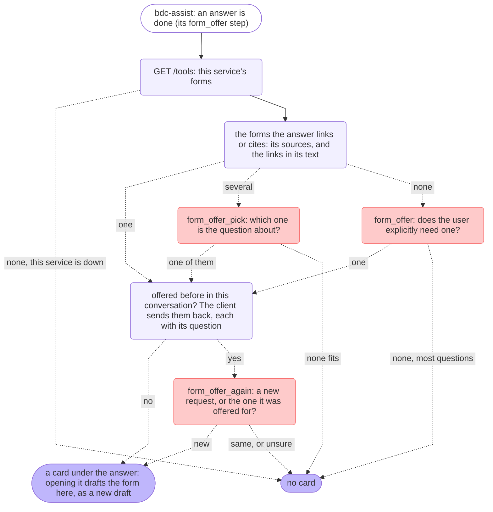

# When the chat offers a form

The mermaid source of `form_offer.png`: how an answer in the main chat gets a form's card. bdc-assist's
`form_offer` step (its BDC config, `examples/bdc/nodes.py` and `prompts.yaml`) decides, and the web client
(`src/lib/bdc-adapter.ts`) shows the card and sends back the forms it was offered; this service only lists the
forms and drafts the one the user opens. Drawn by hand: keep it in step with those, then redraw the picture
(mermaid.ink renders it, so the text below leaves this machine):

    uv run python -c "import re, pathlib as p; d = p.Path('docs'); m = re.search(r'```mermaid\n(.*?)```', (d / 'form_offer.md').read_text(encoding='utf-8'), re.S); from langchain_core.runnables.graph_mermaid import draw_mermaid_png; (d / 'form_offer.png').write_bytes(draw_mermaid_png(m[1]))"

Pastel red: an LLM call, with the prompt it uses. One card per answer at most. A refused question never gets
here, and a rejected answer drops the offer.


