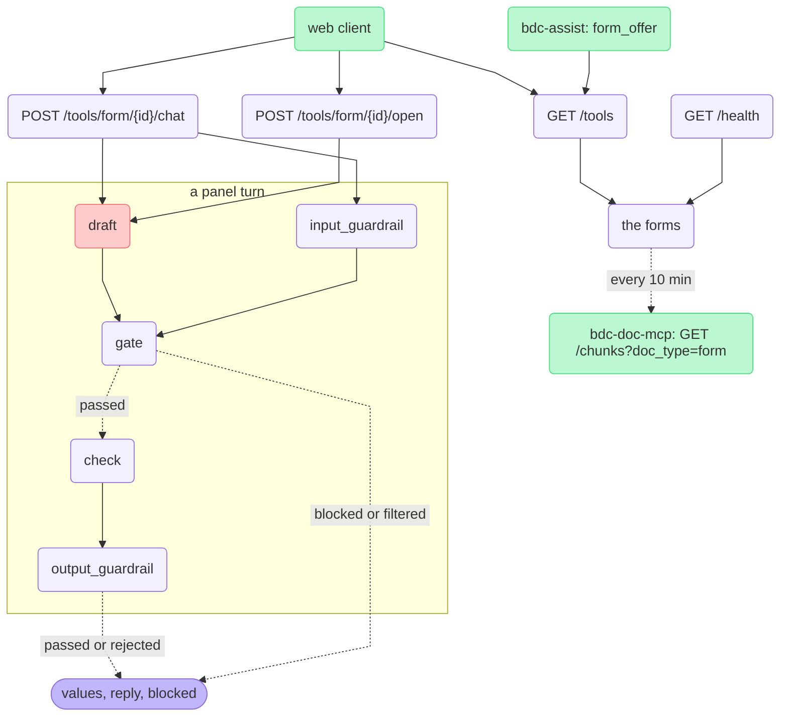

# bdc-side-panel workflow

The mermaid source of `workflow.png`: the service's endpoints, who calls them, and one panel turn
(`side_panel/turn.py`), drawn like bdc-assist's workflow pictures. Drawn by hand, not from the code: keep it in
step with `api.py`, `forms.py` and `turn.py`, then redraw the picture (mermaid.ink renders it, so the text below
leaves this machine):

    uv run python -c "import re, pathlib as p; d = p.Path('docs'); m = re.search(r'```mermaid\n(.*?)```', (d / 'workflow.md').read_text(encoding='utf-8'), re.S); from langchain_core.runnables.graph_mermaid import draw_mermaid_png; (d / 'workflow.png').write_bytes(draw_mermaid_png(m[1]))"


